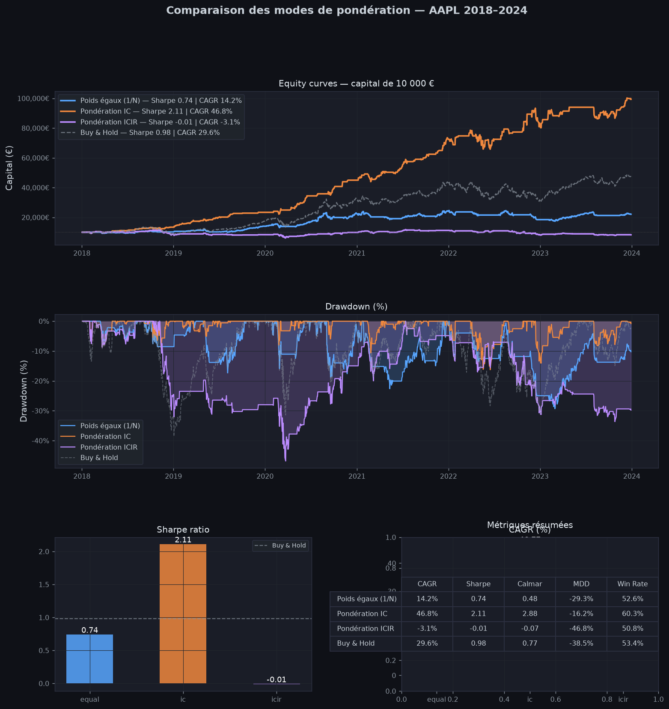
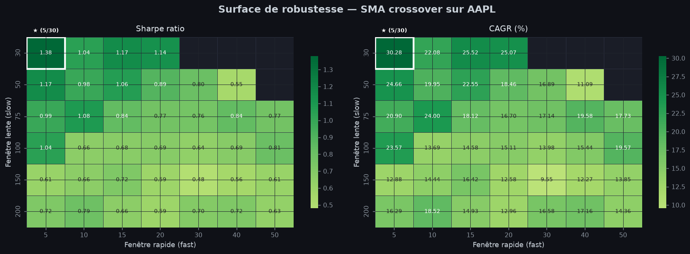
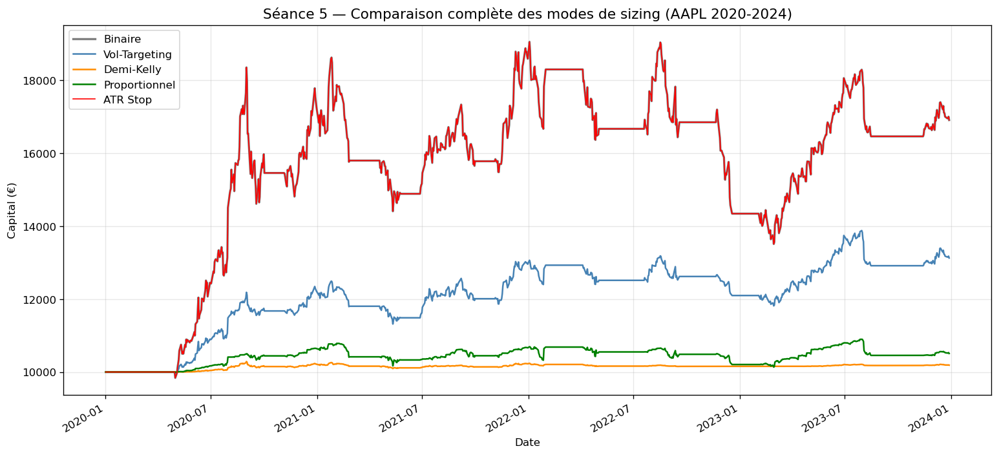

# quant-backtester

Backtester vectorisé en Python, construit de zéro pour tester des stratégies quantitatives avec une attention particulière à la **rigueur statistique** : coûts de transaction réalistes, absence de look-ahead bias et validation hors échantillon.

Le projet couvre toute la chaîne : données, signaux, dimensionnement des positions, coûts, métriques de risque, validation (walk-forward, CPCV), analyse factorielle et stratégies long/short.

## Fonctionnalités

| Module | Contenu |
|---|---|
| `data.py` | Téléchargement OHLCV ajusté (yfinance), calcul des rendements |
| `signals.py` | Croisement de moyennes mobiles, z-score de Bollinger, RSI, MACD, combinaison de signaux |
| `sizing.py` | Position binaire, ciblage de volatilité, demi-Kelly, fraction fixe, proportionnel au signal, stop ATR |
| `costs.py` | Commission, spread, slippage, impact de marché (racine carrée), analyse du turnover |
| `metrics.py` | CAGR, Sharpe, Sortino, Calmar, drawdown max, profit factor, VaR 95 %, nombre de trades |
| `engine.py` | Moteur de backtest (mono-actif et portefeuille), rendements bruts vs nets de coûts, sensibilité aux coûts |
| `validation.py` | Walk-forward (glissant ou ancré), validation croisée purgée avec embargo, Deflated Sharpe, surface de robustesse |
| `factors.py` | Facteurs cross-sectionnels (momentum, volatilité), IC glissant, ICIR, alpha CAPM / Fama-French |
| `combination.py` | Combinaison de signaux pondérée (égale, fixe, IC, ICIR) |
| `portfolio.py`, `pairs.py`, `borrow.py`, `synthetic.py` | Long/short neutre en dollar et en bêta, trading de paires (cointégration), coût d'emprunt, données synthétiques de test |

## Principes de conception

- **Pas de look-ahead bias** : chaque position est décalée d'un jour (`shift(1)`), on décide à la clôture et on exécute le lendemain.
- **Rendements nets** : les coûts de transaction sont soustraits avant le calcul de la courbe de capital, et les métriques brutes restent disponibles pour mesurer leur impact.
- **Validation hors échantillon** : l'optimisation des paramètres se fait sur une fenêtre d'entraînement, l'évaluation sur la fenêtre suivante.
- **Tests** : chaque module est couvert par des tests unitaires `pytest`.

## Installation

```bash
git clone https://github.com/lenaicmarboeuf/quant-backtester.git
cd quant-backtester
python -m venv .venv
source .venv/bin/activate        # Windows : .venv\Scripts\activate
pip install -r requirements.txt
pytest -q
```

Testé avec Python 3.12.

## Exemple d'utilisation

```python
from backtester.data import download_data, compute_returns
from backtester.signals import sma_crossover
from backtester.engine import Backtester

df = compute_returns(download_data("AAPL", "2020-01-01", "2024-01-01"))
signal = sma_crossover(df["Close"], fast=20, slow=50).fillna(0)

# Coûts par défaut (commission + spread + slippage)
bt = Backtester(df, initial_capital=10_000, transaction_costs={})
out = bt.run(signal)

print(out["metrics"])          # métriques nettes de coûts
print(out["gross_metrics"])    # métriques brutes, pour mesurer le drag des coûts
print(out["cost_analysis"])    # turnover, Sharpe net, coût annuel
```

Validation walk-forward :

```python
from backtester.validation import walk_forward

wfo = walk_forward(
    df, sma_crossover,
    param_grid={"fast": [10, 20, 30], "slow": [40, 60, 80]},
    is_window=252, oos_window=63,
)
print(wfo["summary"])
```

## Résultats

Les figures ci-dessous sont générées par les notebooks du dossier `notebooks/` et sauvegardées dans `reports/`.







## Structure du dépôt

```
backtester/   modules de la bibliothèque
tests/        tests unitaires et d'intégration (pytest)
notebooks/    analyses détaillées (stratégie, métriques, sizing, facteurs, long/short)
scripts/      scripts exécutables
reports/      figures et rapports générés
```

## Limites connues

- Les données viennent de yfinance (gratuit, ajusté) : pas de données intraday, et le **biais de survie** sur les univers multi-actifs n'est pas encore corrigé.
- Le moteur mono-actif est long uniquement ; le long/short est géré par la couche portefeuille.
- L'impact de marché est désactivé par défaut (adapté à de petits ordres sur des actions liquides).
- Projet pédagogique : les résultats ne constituent pas un conseil en investissement.

## Références

- Lopez de Prado, *Advances in Financial Machine Learning* (2018) : validation croisée purgée, Deflated Sharpe Ratio
- Almgren & Chriss (2001) : modèle d'impact de marché
- Chan, *Algorithmic Trading* : coûts de transaction, trading de paires
